# LinguaFlow

## Описание приложения

LinguaFlow — приложение для изучения английского языка на iPhone. В нём собраны аудиокурс из 90 уроков, личный словарь, повторение карточек и достижения за регулярные занятия. На главном экране можно продолжить урок с того места, где остановился, или перейти к словам.

## Скриншоты и демо-видео

Скриншоты основных экранов приложения в светлой и тёмной темах.

### Скриншоты

#### Светлая тема

<div style="display: flex; gap: 10px;">
    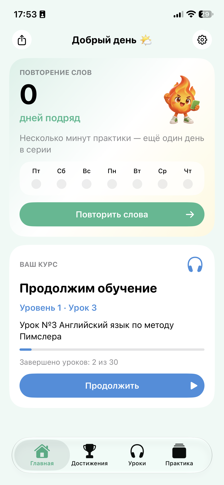
    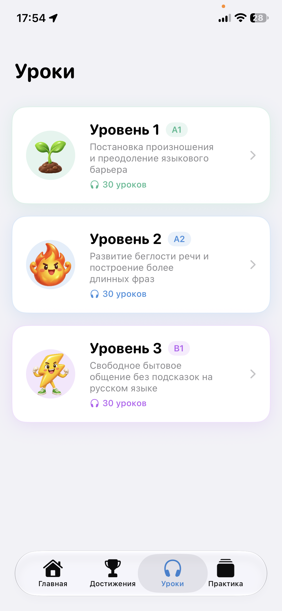
    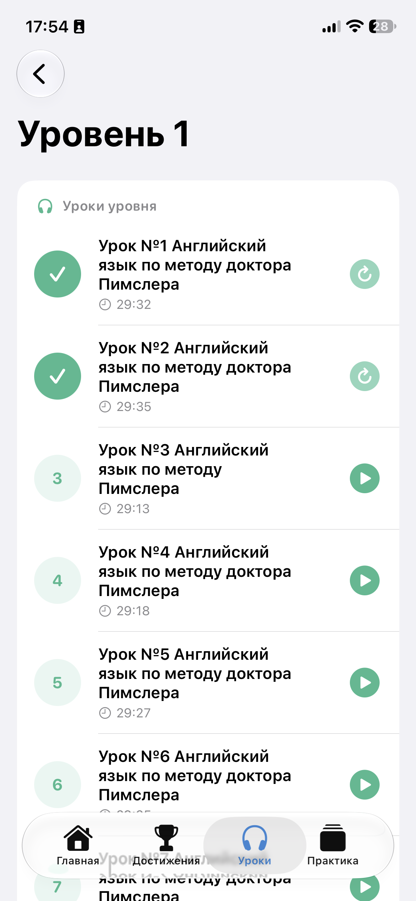
    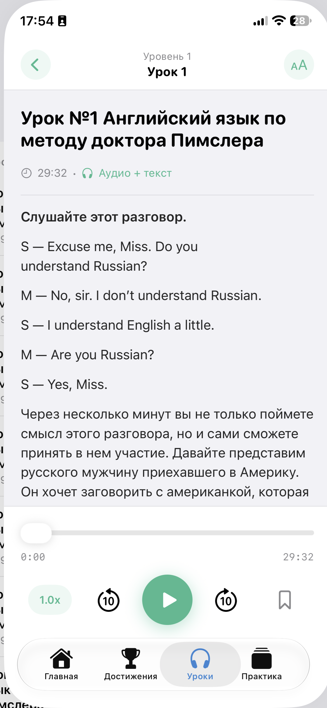
</div>

<div style="display: flex; gap: 10px;">
    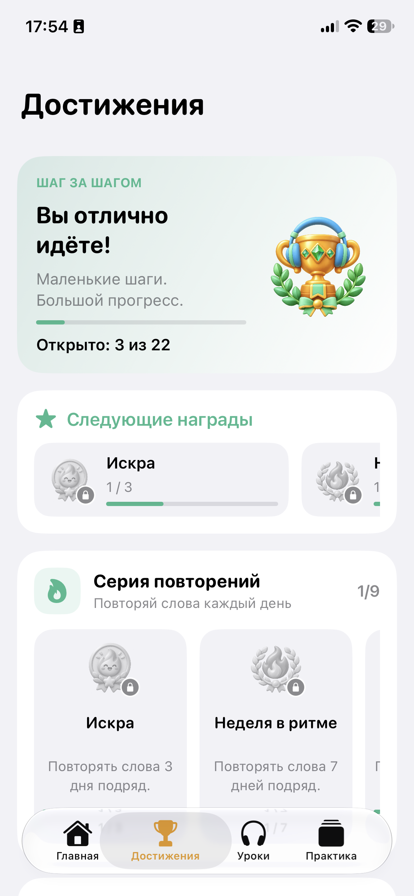
    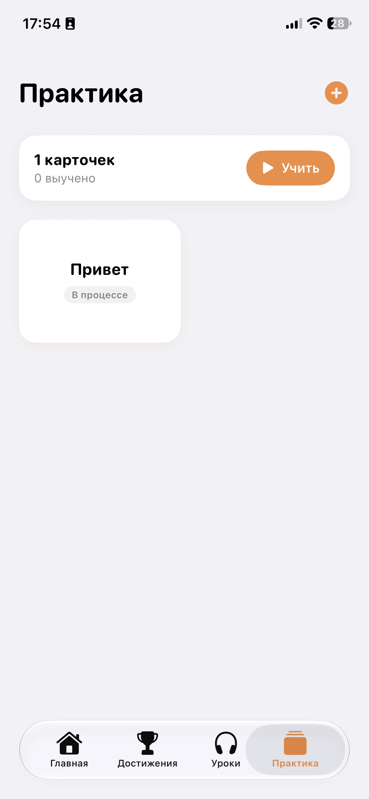
    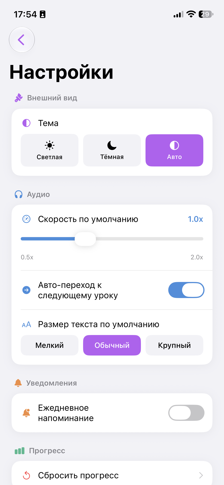
</div>

#### Тёмная тема

<div style="display: flex; gap: 10px;">
    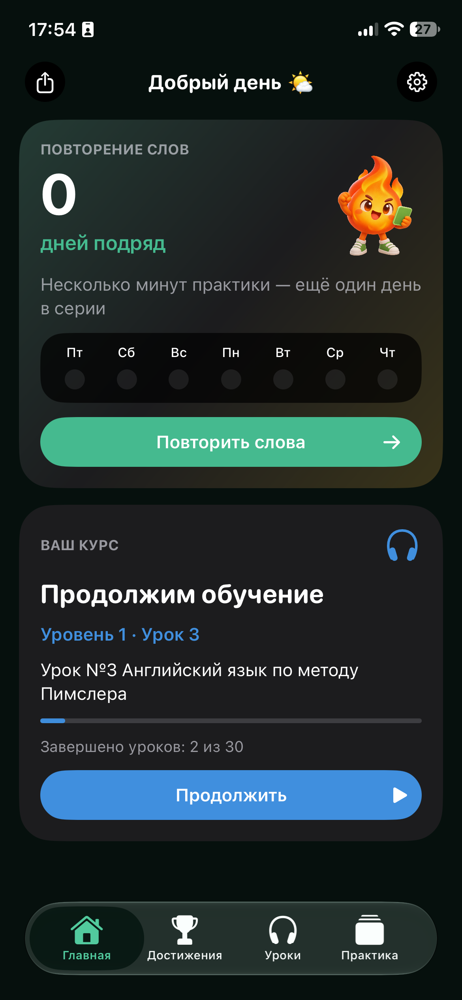
    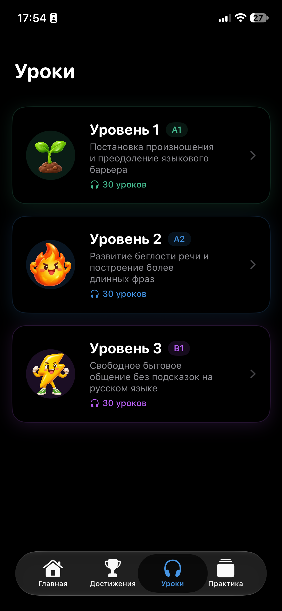
    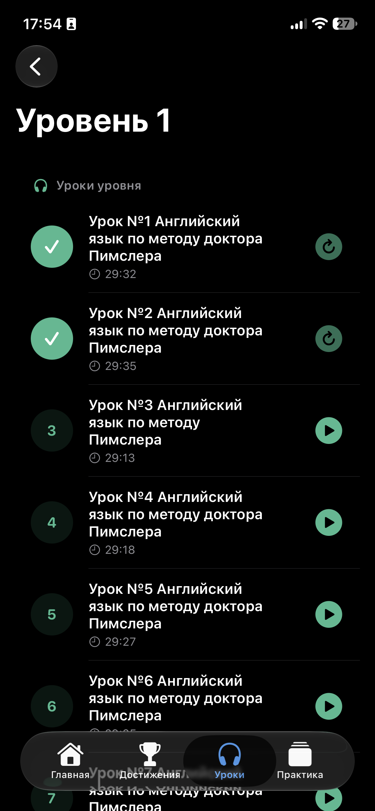
    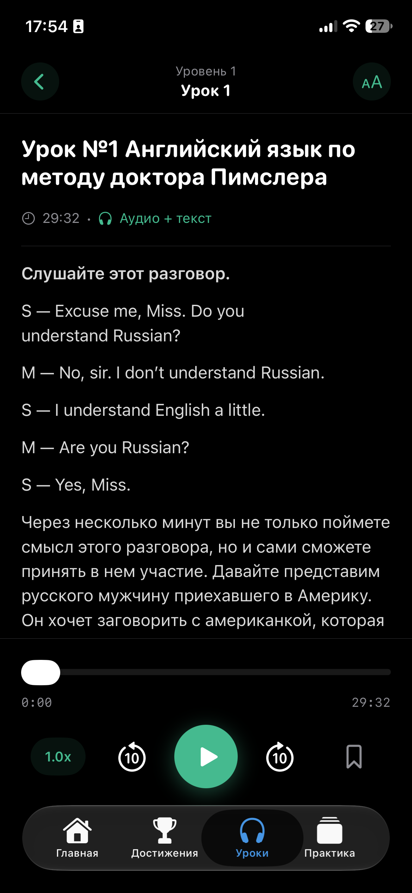
</div>

<div style="display: flex; gap: 10px;">
    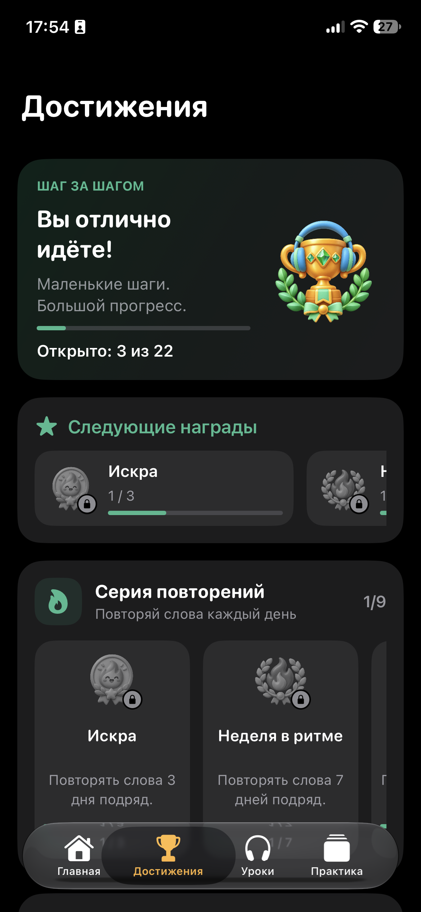
    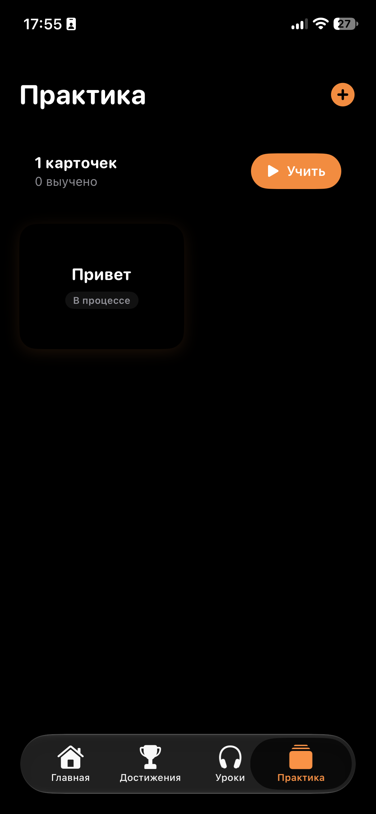
    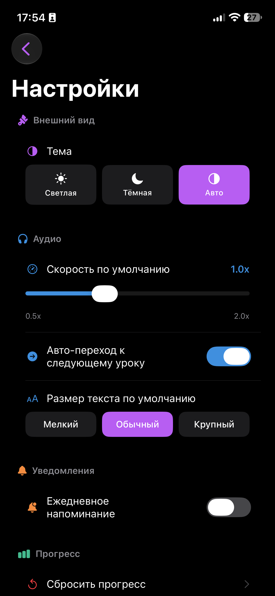
</div>

### Демо-видео

Демо-видео будет добавлено позже.

## Стек

- Swift 5 и Xcode 26.4+
- SwiftUI — экраны, навигация и системная тема.
- Core Data — карточки и прогресс уроков.
- Combine — обновление экранов при изменении прогресса и словаря.
- AVFoundation — воспроизведение аудио уроков и управление скоростью.
- UserNotifications — ежедневное напоминание о повторении слов.
- UserDefaults — настройки, история повторений и каталог полученных достижений.
- Lottie — анимация получения достижения.
- SwiftLint — проверка стиля Swift-кода.
- Архитектура: SwiftUI-экраны по функциональным разделам и общие ObservableObject-сервисы для состояния и данных.

## Назначение и цели приложения

Приложение помогает регулярно заниматься английским: слушать уроки, добавлять полезные слова и возвращаться к ним для повторения.

Цели приложения:

- пройти аудиокурс последовательно, сохраняя место в уроке;
- создать личный словарь с переводами и примерами;
- поддерживать серию ежедневных повторений;
- видеть прогресс в уроках, словаре и достижениях.

## Функциональные требования

### Главный экран

Главный экран содержит:

- приветствие, которое меняется в зависимости от времени суток;
- карточку повторения слов с текущей серией и отметками за последние дни;
- кнопку для запуска повторения или добавления первой карточки;
- карточку курса с последним открытым либо следующим незавершённым уроком;
- переход в настройки и возможность поделиться серией повторений.

Карточка курса показывает уровень, номер и название урока, а также прогресс уровня. Если выбранный урок уже завершён, приложение предлагает следующий незавершённый урок.

### Уроки и аудиокурс

Курс состоит из трёх уровней по 30 уроков. На экране уровней показаны описание курса и прогресс; список уроков отображает длительность и состояние каждого занятия.

Внутри урока доступны:

- аудиозапись и текст урока;
- воспроизведение, пауза, перемотка на 10 секунд и ползунок позиции;
- скорость от 0,5x до 2x;
- выбор размера текста;
- автоматический переход к следующему уроку, если он включён в настройках.

Позиция аудио сохраняется, поэтому урок можно продолжить позже. Завершение аудиозаписи отмечает урок пройденным. Аудиофайлы и материалы курса входят в приложение.

### Создание карточки слова

На экране «Практика» можно создать карточку. Для сохранения обязательны слово и перевод; пример использования необязателен.

Карточки можно просматривать в сетке, нажатием открывать перевод, запускать сессию повторения и удалять карточку через контекстное меню.

### Повторение слов

Во время сессии сначала показывается слово. Нажатие открывает перевод и, если он добавлен, пример использования.

- «Знаю» передвигает карточку на следующий уровень изучения.
- «Не знаю» возвращает карточку на начальный уровень.
- После ответа на карточку день отмечается как день повторения; несколько ответов за один день не увеличивают серию несколько раз.
- По окончании сессии показывается экран завершения.

Текущая версия отслеживает уровни изучения карточек, но пока не планирует отдельную дату следующего повторения для каждой карточки.

### Достижения

Достижения собраны в блоки по серии повторений, словарю и урокам. Для каждой награды отображаются условие и прогресс. Получение новой награды сопровождается отдельным экраном с анимацией.

Каталог включает награды за:

- добавление 1, 10, 25, 60, 100, 500 и 1000 уникальных слов;
- изучение 100 карточек;
- первый урок, завершение уровня и прохождение уровней 2 и 3;
- серию повторений от 1 до 365 дней;
- завершение всего курса.

Полученные награды сохраняются и не отнимаются при удалении карточек или сбросе текущего учебного прогресса.

### Настройки

В настройках доступны:

- светлая, тёмная и системная темы;
- скорость воспроизведения по умолчанию;
- автоматический переход к следующему уроку;
- размер текста урока по умолчанию;
- ежедневное локальное уведомление с выбором часа;
- сброс прогресса уроков, выученности карточек и серии повторений.

Сброс сохраняет сами слова и уже полученные достижения.

## Хранение данных и приватность

Карточки, уроки и настройки хранятся локально на устройстве. Приложение не требует аккаунта и не отправляет учебный прогресс на сервер.

| Данные | Хранилище |
| --- | --- |
| Слова, переводы, примеры и уровень изучения карточки | Core Data |
| Позиция аудио и завершение уроков | Core Data |
| Тема, размер текста и скорость воспроизведения | UserDefaults |
| Дни повторений и история добавленных слов | UserDefaults |
| Полученные награды и очередь анимаций | UserDefaults |
| Содержание уроков, каталог наград и аудиофайлы | Ресурсы приложения |

## Структура проекта

```text
LinguaFlow/
├── App/                 Точка входа и Core Data
├── Core/
│   ├── Models/          Модели курса, карточек и достижений
│   ├── Services/        Хранение данных, аудио, уведомления и прогресс
│   └── UI/              Общие элементы интерфейса
├── Features/
│   ├── Achievements/    Экран достижений и подробности наград
│   ├── Flashcards/      Словарь и повторение карточек
│   ├── Home/            Главный экран и публикация серии
│   ├── Lessons/         Уровни курса и аудиоуроки
│   └── Settings/        Настройки приложения
├── Navigation/          Вкладки приложения
├── Assets.xcassets/     Иконка, иллюстрации и изображения достижений
└── Resources/
    ├── Animations/      Анимация получения достижения
    ├── Audio/           Аудиозаписи курса
    └── Data/            Уроки и каталог достижений
```

## Запуск проекта

1. Открой `LinguaFlow.xcodeproj` в Xcode 26.4 или новее.
2. Выбери схему `LinguaFlow` и симулятор или подключённый iPhone с iOS 26.4+.
3. Нажми `⌘R`. Xcode загрузит Lottie через Swift Package Manager при первой сборке.

Для ручной проверки стиля установи SwiftLint и запусти из корня репозитория:

```sh
brew install swiftlint
swiftlint lint --config .swiftlint.yml
```

## Что можно развить дальше

- планировщик интервальных повторений с очередью слов на сегодня;
- поиск, редактирование и экспорт карточек;
- экран подробной статистики по урокам и повторениям;
- синхронизацию и резервное копирование словаря;
- закладки для важных моментов аудиоурока.
